# Estética em Pixel Art — 7 Hell's

Toda a parte visual do jogo foi refeita em **pixel art**, com uma paleta única de tema "inferno".
**Nada de jogabilidade foi alterado**: posições, tamanhos (Transforms), colisores, Rigidbodies, tags e os
scripts do jogo (`Assets/Scripts`) continuam exatamente iguais. Só mudou o que se vê.

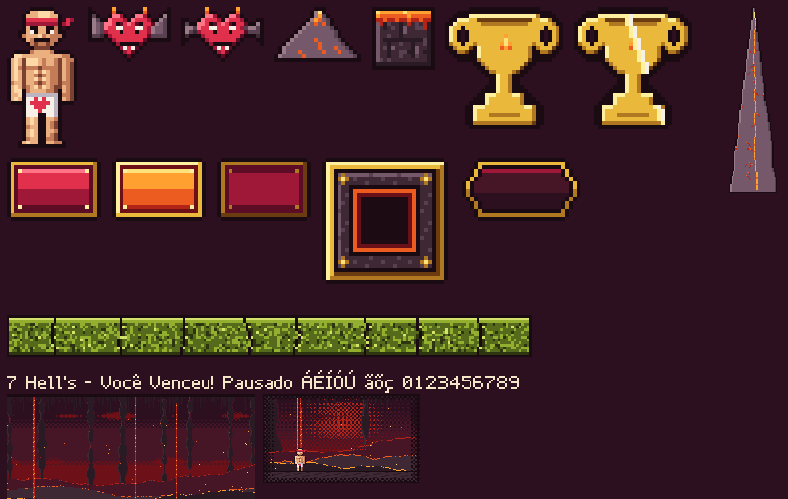

## Capturas

| | | |
|---|---|---|
| 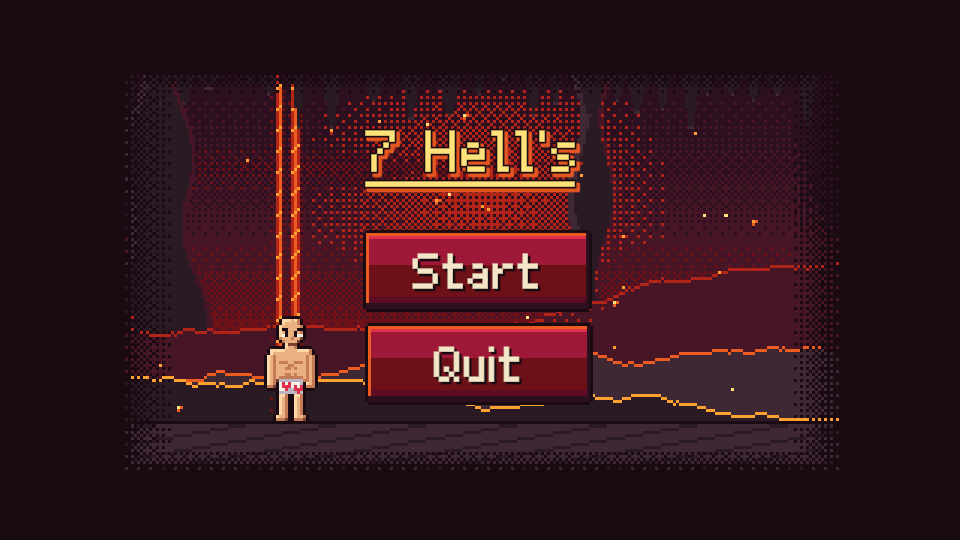 Menu | 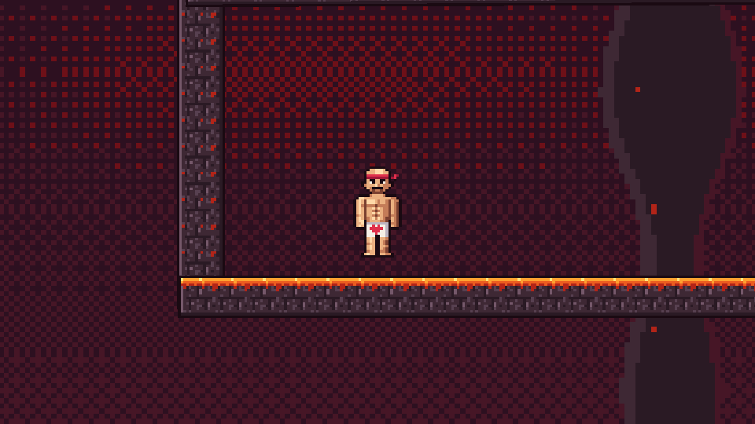 Fase 1 – início | 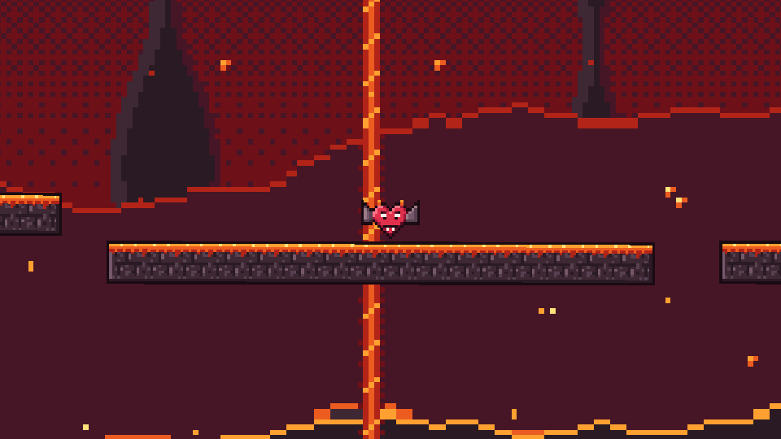 Demônio-coração |
| 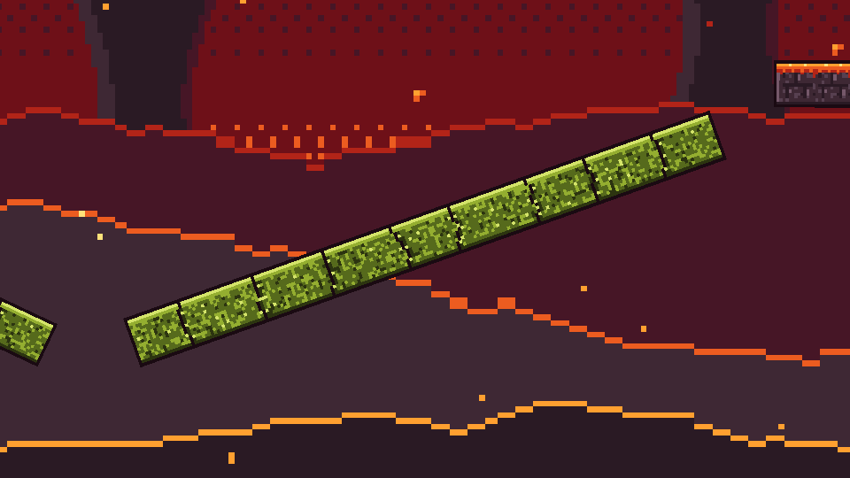 Plataformas que somem | 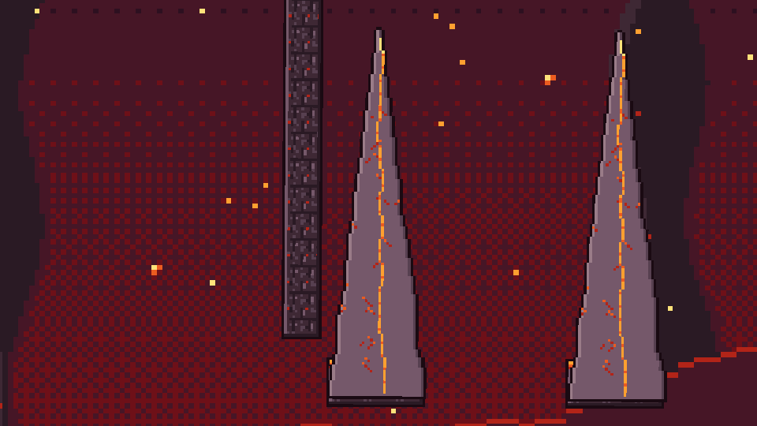 Estalagmites | 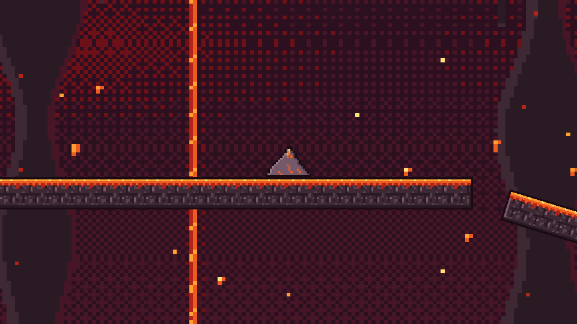 Espinho na rampa |
| 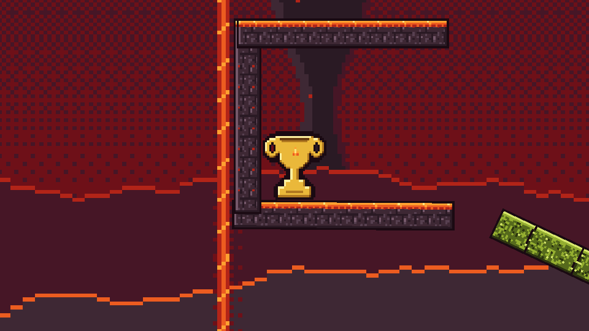 Troféu da fase 1 | 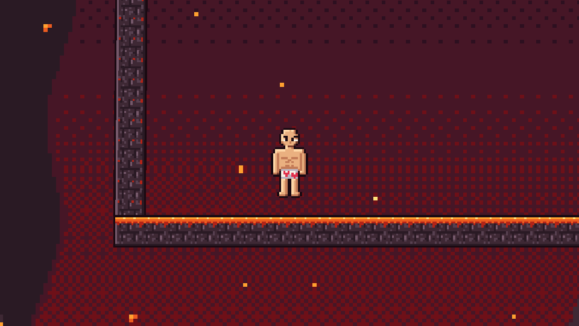 Fase 2 – início | 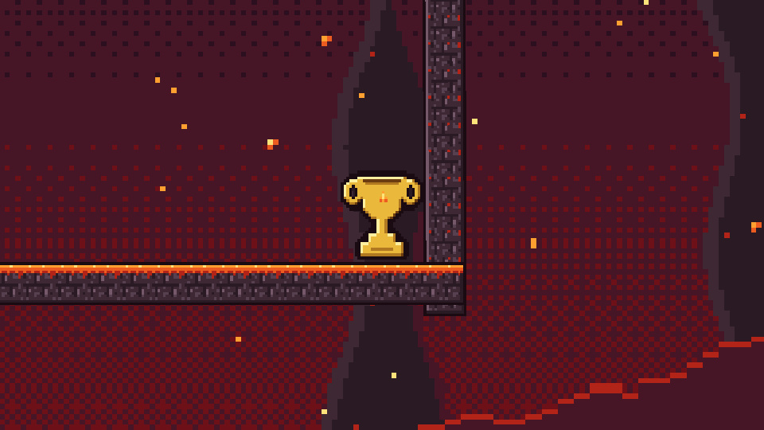 Troféu da fase 2 |
| 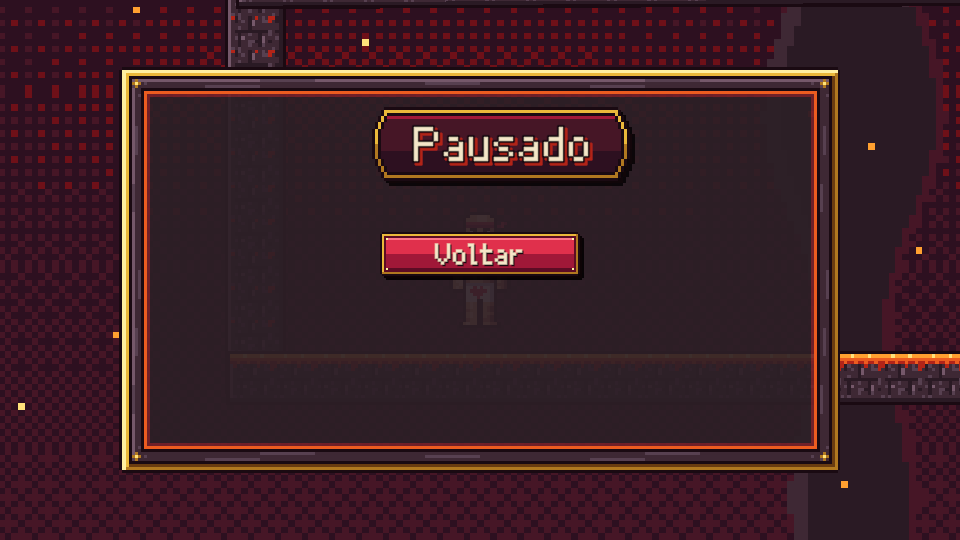 Pause | 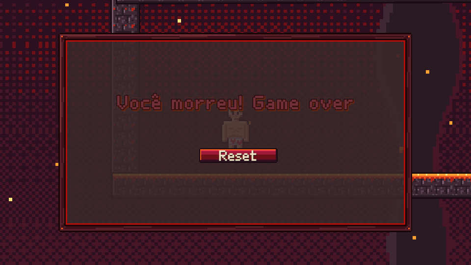 Game over | 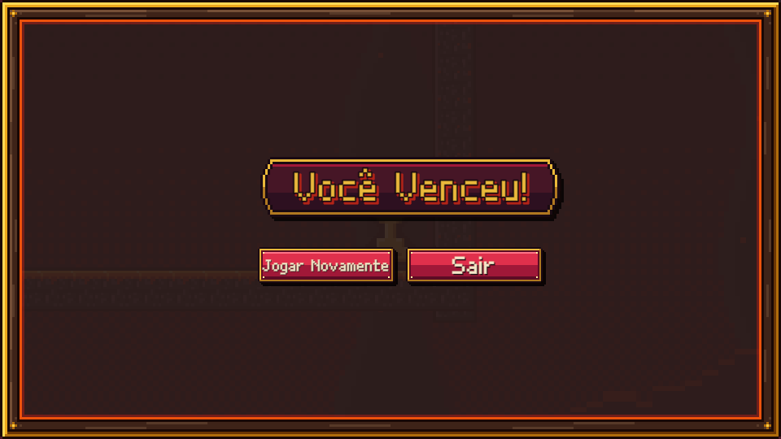 Vitória |

> As capturas são geradas automaticamente pela Unity (sem dar Play), então as animações aparecem paradas.

## Organização das pastas

```
Assets/
├── Art/                         ← TODA a arte do jogo
│   ├── Sprites/
│   │   ├── Personagens/         agenor.png (o player) + Animacao/ (quadros parado, andando e pulo)
│   │   ├── Inimigos/            demonio_coracao_0/1.png (2 quadros de animação)
│   │   ├── Cenario/             tile_rocha, plataforma_dissolvivel, espinho, estalagmite, fundo_inferno
│   │   ├── Objetos/             trofeu_0..3.png (brilho animado)
│   │   └── UI/                  botao (+ _hover e _press), painel, faixa_titulo, fundo_menu
│   ├── Animacoes/               Demonio (asas batendo) e Trofeu (brilho) — clips + controllers
│   ├── Fontes/                  PixelInferno.ttf + PixelInferno SDF (TextMeshPro) + materiais
├── Audio/Resources/Sons/        efeitos sonoros (.wav) gerados por código
│   └── _Antigos/                sprites antigos (não usados mais, guardados por segurança)
├── Editor/PixelArt/             ferramentas de Editor (não vão para o jogo final)
│   ├── PixelArtImporter.cs      configura imagens novas como pixel art automaticamente
│   └── AplicarVisualPixelArt.cs aplica o visual nas cenas + tira as capturas
├── Scenes/  Scripts/  Settings/ (sem mudanças nos scripts)
Tools/PixelArt/gerar_pixel_art.py ← gera TODOS os PNGs e a fonte
Tools/Audio/gerar_sons.py         ← gera TODOS os efeitos sonoros
Docs/                              ← esta documentação, preview e capturas
```

## Paleta

| Grupo | Cores | Uso |
|---|---|---|
| Contorno / noite | `#1a0a12` `#2d1020` `#461626` | contornos, céu da caverna, fundo da câmera |
| Rocha vulcânica | `#2a1a24` `#3e2834` `#574050` `#75586a` `#9a7c88` | chão, paredes, espinhos, painéis |
| Lava | `#6e1018` `#b22418` `#ec5c20` `#ffa030` `#ffe27a` | crosta do chão, cascatas, brasas, detalhes |
| Pele (Agenor) | `#7a4030` `#c47c58` `#eab080` `#ffd8a8` | player |
| Coração | `#5c0c24` `#a01838` `#e0304c` `#ff7486` | inimigos, corações da cueca, texto de game over |
| Ouro | `#6a3c10` `#b07820` `#eab83a` `#fff0a0` | troféu, texto de vitória |
| Enxofre | `#2c3410` `#566a1c` `#94ae30` `#d4e46a` | plataformas que somem (eram verdes antes) |
| Texto | `#f4e6c8` | textos dos botões e títulos |

Regras do estilo: contorno escuro de 1 pixel em tudo, luz vindo de **cima/esquerda**, sombreamento por rampas de 4–5 tons e
*dithering* (xadrez de pixels) nos degradês.

## O que mudou em cada coisa

| Antes | Agora | Detalhe técnico |
|---|---|---|
| Agenor (foto recortada) | Agenor 18×36 px desenhado pixel a pixel: bandana vermelha, sobrancelhas bravas, bigode, tanquinho e cueca de coração | mesmo tamanho na tela (PPU 24.49); o desenho fica na tabela `AGENOR_CABECA`/`AGENOR_TRONCO` do script |
| Inimigo coração | Demônio-coração com chifres e asas de morcego | animação de 2 quadros (Animator só troca o sprite) |
| Espinho cinza | Espinho de rocha com ponta incandescente | o `PolygonCollider2D` antigo foi mantido |
| Espinho gigante (esticado) | Estalagmite de 38×142 px com veio de lava | sprite "pré-esticado" para os pixels ficarem quadrados |
| Chão/paredes (quadrado marrom) | Ladrilho de rocha com crosta de lava | objeto filho **"Visual (pixel art)"** com modo *Tiled*; o quadrado antigo só foi desligado |
| Plataforma que some (verde) | Plataforma de enxofre rachada | o sprite fica no próprio objeto, então continua piscando pelo script |
| Troféu | Troféu de ouro com chama e brilho animado | animação de 7 quadros |
| Fundo do inferno | Caverna infernal: pilares, névoa de brasa, cascatas e mar de lava | gerado por código, 8 px por unidade |
| UI padrão da Unity | Botões vermelhos com aro dourado e rebites, painéis com moldura dourada + rocha + filete de lava, títulos em uma faixa dourada | *9-slice*, 1 pixel da arte = 2 a 4 pixels da tela |
| Fonte LiberationSans | Fonte própria **PixelInferno** (com acentos: ã, ç, ê...) | `.ttf` gerado pelo script + asset SDF do TextMeshPro |
| Fundo do menu | Paisagem do inferno com o Agenor ao lado dos botões | |

Também mudou:
- A cor de fundo das câmeras virou `#1a0a12`, para não aparecer azul onde o desenho do fundo termina.
- O fundo ganhou *Sorting Order* -100, para ficar sempre atrás de tudo.
- **Textos:** fonte nova, cores da paleta e tamanhos múltiplos de 8. Os títulos não quebram mais de linha
  ("Você morreu! Game over" fica numa linha só).
- **Botões mais destacados:** cada botão tem 3 desenhos — normal (vermelho), mouse em cima (laranja brilhante) e
  clicado (afundado). A troca é feita pelo próprio `Button` (transição *Sprite Swap*). Todos ganharam uma sombra
  (componente `Shadow`) para "saltarem" da tela.
- **Botões das telas de pause / game over / vitória** ficaram maiores: 200×44 (ou 168×44 quando há outro botão do
  lado, como "Jogar Novamente" e "Sair"). Só o tamanho do retângulo da UI mudou; posições e funções dos botões são as mesmas.
- **Títulos** ("7 Hell's", "Pausado", "Você morreu! Game over", "Você Venceu!") ficam centralizados sobre uma faixa
  com borda dourada. Ela é um objeto novo, **"Faixa do titulo (pixel art)"**, criado logo antes do texto na hierarquia
  (só imagem, não recebe clique).
- No game over, o painel passou a ser desenhado antes do título (ordem na hierarquia), porque o fundo
  semitransparente dele estava apagando o texto.

## Animação do player
O Agenor tem 7 quadros em `Assets/Art/Sprites/Personagens/Animacao/` (gerados a partir do desenho base pelo
`gerar_pixel_art.py`, função `agenor_quadros()`):

| Estado | Quadros | Velocidade |
|---|---|---|
| Parado | `agenor_parado_0/1` (respirando: o peito "murcha" 1 pixel) | 2 quadros/s |
| Andando | `agenor_andando_0..3` (levanta um pé, depois o outro) | 10 quadros/s |
| No ar | `agenor_pulo` (pernas encolhidas, mãos para cima) | — |

Quem troca os quadros é o script `Assets/Scripts/PlayerAnimacao.cs`, que está no objeto **Player**. Ele olha a
velocidade do Rigidbody e se o player está no chão (`Player.IsGrounded`, que virou público só para isso) e também
vira o desenho para o lado em que ele anda. Ele não mexe na física nem nos controles.

## Efeitos sonoros
Todos os sons são gerados por código, no estilo 8 bits, pelo `Tools/Audio/gerar_sons.py` (só Python puro, sem
programa de áudio). Para mudar um som, edite a função dele no script e rode `python Tools/Audio/gerar_sons.py`.

| Som | Quando toca | Onde é chamado |
|---|---|---|
| `pulo` | ao pular | `Player.cs` |
| `aterrissar` | ao cair no chão vindo de um pulo/queda | `Player.cs` |
| `morte` | ao morrer (espinho, inimigo ou queda) | `MenuScene.MostrarGameOver` |
| `plataforma` | quando a plataforma que pisca desmorona | `PlataformaDissolvivel.cs` |
| `fase` | ao pegar o troféu da fase 1 | `Vitoria.cs` |
| `vitoria` | ao pegar o troféu da fase 2 | `TelaVitoria.cs` |
| `pause` | ao pausar com ESC | `MenuScene.Pausar` |
| `clique` | em **qualquer** botão | automático |

O script `Assets/Scripts/Sons.cs` se cria sozinho quando o jogo abre (não precisa colocar em nenhuma cena), carrega
os `.wav` da pasta `Audio/Resources/Sons` e continua vivo ao trocar de cena, então o som não corta quando a fase
recarrega. Para tocar um som em outro script: `Sons.Tocar("nome_do_arquivo");`. O volume geral fica em `Sons.volume`.

## Hitboxes (caixas de colisão)
O player morria "sem encostar" porque as caixas de colisão eram maiores que os desenhos:

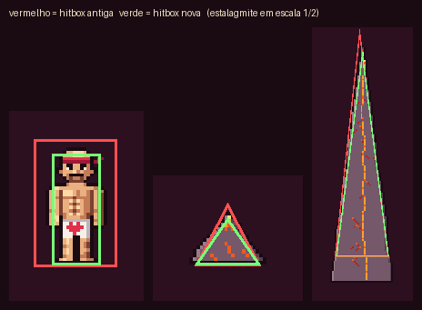

| Objeto | Antes | Agora |
|---|---|---|
| Player | caixa 1,3× mais larga que o corpo e passando da cabeça | caixa do corpo (14×34 px do desenho), pé na base do desenho |
| Espinho pequeno | ponta do triângulo bem acima da ponta do desenho | triângulo um pouco menor que o desenho (a pontinha brilhante não mata) |
| Estalagmite (espinho grande) | ponta ~0,5 unidade acima do desenho | ponta logo abaixo da ponta do desenho |
| Demônio-coração | caixa mais alta que o desenho | caixa do corpo, pé na base do desenho |

Os valores ficam em `AjustarHitboxes()` dentro do `AplicarVisualPixelArt.cs` e são aplicados pelo mesmo menu
`Ferramentas > Pixel Art > Aplicar visual nas cenas`.

### O que NÃO mudou na parte visual (conferido)
Na reforma visual, as cenas foram comparadas antes e depois, componente por componente. Continuaram idênticos
(as únicas mudanças de jogo depois disso são as hitboxes acima e as chamadas de som nos scripts):
- todos os Transforms (posição, rotação e escala);
- todos os colisores (`BoxCollider2D` e `PolygonCollider2D`) e Rigidbodies;
- as tags;
- os valores dos scripts do jogo.

A única diferença que aparece nos colisores é o campo `oldSize`. É um dado do "auto tiling", que está
desligado em todos eles, então não afeta a colisão.

### Por que existe o objeto "Visual (pixel art)" dentro de cada chão?
Os blocos de chão são quadrados com escala esticada (ex.: `18 x 1`). Se o ladrilho fosse colocado direto neles, ele
ficaria esticado 18 vezes. Então cada bloco ganhou um filho só de visual, com escala inversa, que repete o ladrilho
no tamanho certo. O colisor e a tag continuam no bloco original. **Se você mudar o tamanho de um chão**, rode de novo o
menu `Ferramentas > Pixel Art > Aplicar visual nas cenas` que o visual se ajusta.

## Como criar ou editar a arte

1. **Editar algo existente:** mude o desenho no `Tools/PixelArt/gerar_pixel_art.py` (cada sprite é uma função:
   `agenor()`, `demonio()`, `tile_rocha()`...) e rode na raiz do projeto:
   ```bash
   python Tools/PixelArt/gerar_pixel_art.py
   ```
   Também dá para abrir os PNGs em um editor de pixel art (Aseprite, Piskel, LibreSprite) e editar à mão —
   só lembre que rodar o script de novo sobrescreve os PNGs.
2. **Sprite novo:** salve o PNG em `Assets/Art/Sprites/<pasta>/`. O `PixelArtImporter` já configura sozinho:
   filtro *Point*, sem compressão e **16 pixels = 1 unidade** (o tamanho dos ladrilhos).
3. **Aplicar nas cenas de novo:** na Unity, menu `Ferramentas > Pixel Art > Aplicar visual nas cenas`.
4. **Atualizar as capturas desta página:** `Ferramentas > Pixel Art > Capturar telas para a documentação`.

## Dicas para manter o estilo
- Use só cores da paleta acima.
- Personagens e objetos novos: 16 px = 1 unidade do mundo.
- Sempre contorno escuro (`#1a0a12`) e luz de cima/esquerda.
- Textos: use a fonte `PixelInferno SDF` em tamanhos múltiplos de 8 (16, 24, 32, 40...).
  Para títulos use o material `PixelInferno SDF - Titulo`; em botões, `PixelInferno SDF - Sombra`.
